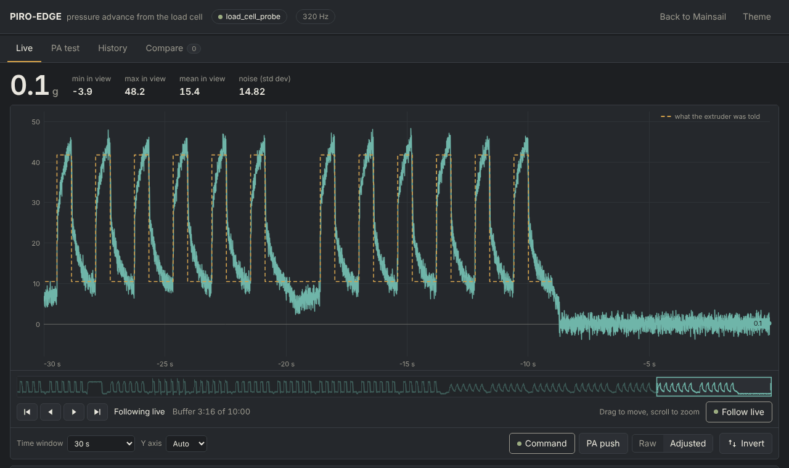
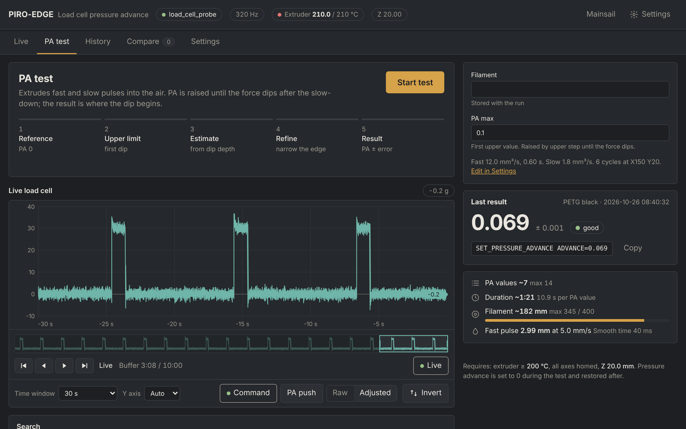
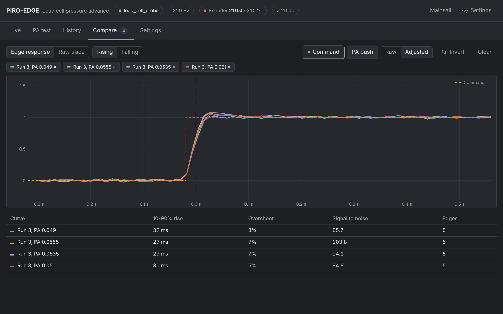

# PIRO-EDGE

Pressure advance calibration for Klipper using the load cell on the **PIRO-AIR** toolhead (HX717, 320 Hz).
The nozzle extrudes short fast and slow pulses into the air while the load cell measures the push. PIRO-EDGE finds
the PA at which the force starts to dip below its new level after a slow-down. That is the point where PA becomes too
much. The result is the value to use, with an uncertainty and a grade.


Works with `[load_cell]` or `[load_cell_probe]`. Runs inside Mainsail as a **Load Cell** page in the sidebar.

> Tested offline against Klipper's load cell code and a simulated extruder. Not yet verified on every printer. Run
> `PA_LOADCELL_DIAG` once before the first test.

## Install

```bash
git clone https://github.com/VcikeyTheCoder/piro-air-pa-calibrator.git
cd piro-air-pa-calibrator && bash install.sh
```

Update: `cd ~/piro-air-pa-calibrator && git pull && bash install.sh` (or the Update button on Mainsail's Machine page).
Uninstall: `bash install.sh --uninstall` (config and recorded runs are kept).

The installer links the Klipper module, creates or updates `pa_loadcell.cfg`, adds `[include pa_loadcell.cfg]`,
adds the sidebar link, the nginx route `/loadcell/` and the Moonraker update entry, then restarts the services.
Existing configs keep your values; old options are commented out. Backups are saved as `*.bak-pa_loadcell`.

After installing, set `test_x/test_y` and `park_x/park_y`, then refresh Mainsail (Ctrl+F5).

## Configuration

```
[pa_loadcell]
load_cell: load_cell_probe
#   Name of the [load_cell] or [load_cell_probe] section.
pa_max: 0.10
#   First high PA tested. It must make the force dip.
upper_step: 0.02
#   Added to pa_max while there is no dip.
pa_limit: 0.20
#   No dip up to this value: the test fails.
cycles: 6
#   Fast + slow pulses per PA value. The first one is skipped.
fast_flow: 12
fast_time: 0.6
#   Fast leg, mm³/s and seconds.
slow_flow: 1.8
slow_time: 1.0
#   Slow legs, mm³/s and seconds.
prime_length: 20
prime_flow: 12
prime_rest: 1
#   Filament pushed before the first PA value (mm, mm³/s), then a pause (s).
rest_time: 0.3
#   Pause before every PA value (s).
max_filament: 400
#   A test that could use more filament (mm) is refused.
skip_first_pulse: 1
#   1 = ignore the first pulse of every PA value.
test_x:
test_y:
#   Where the nozzle extrudes into the air. Required.
park_x:
park_y:
#   Where the nozzle waits after the test. Required.
#filament:
#   Name saved with each run.
min_temp: 200
#   The test refuses to start below this nozzle temperature.
required_z: 20
z_tolerance: 0.5
#   Z height the test must start at.
sample_timeout: 3
#   Seconds without load cell data before the test stops.
data_dir: ~/printer_data/pa_loadcell
#   Where runs are stored.
ring_size: 60000
live_idle: 15
max_record_seconds: 300
#   Live buffer size (samples), seconds the stream stays on after the last
#   viewer, and the limit for manual recordings.
```

No change to `[extruder]` is needed. The pulses are extrude-only, so `max_extrude_cross_section` does not apply.
The fast flow and the PA push must stay under `max_extrude_only_velocity`; the page and the test check this.

## Commands

#### PA_LOADCELL_TEST
`PA_LOADCELL_TEST [PA_MAX=<value>] [UPPER_STEP=<value>] [PA_LIMIT=<value>] [CYCLES=<count>]
[FAST_FLOW=<mm³/s>] [FAST_TIME=<s>] [SLOW_FLOW=<mm³/s>] [SLOW_TIME=<s>] [PRIME_LENGTH=<mm>] [PRIME_FLOW=<mm³/s>]
[PRIME_REST=<s>] [REST_TIME=<s>] [SKIP_FIRST=<0|1>] [MAX_FILAMENT=<mm>] [TEST_X=<mm>] [TEST_Y=<mm>]
[PARK_X=<mm>] [PARK_Y=<mm>] [FILAMENT=<name>]`: Runs the PIRO-EDGE test. Any parameter left out comes from
`[pa_loadcell]`. The nozzle must be hot, all axes homed and Z at `required_z`. Klipper's pressure advance is held at
0 during the test and restored afterwards. The result is printed in the console and saved as a run.

#### PA_LOADCELL_DIAG
`PA_LOADCELL_DIAG`: Reads the load cell for 3 seconds and reports the sample rate and how far the newest sample is
behind print time. Expect about 320 samples/s and 0.1 to 1.0 s.

## The page

Open **Load Cell** in the Mainsail sidebar, or `http://<printer>/loadcell/`.

### Live



Current force and the last 10 minutes of load cell data. Drag or scroll to move and zoom, **Follow live** to return.
**Tare** zeroes the load cell. **Record** saves a recording, and **Mark** adds a note to it.

### PA test



**Start test** runs the test. The five steps show how far it is, and the live graph shows the pulses. The panel on the
right holds the filament name and *Check up to* (`pa_max`). **Pulses, prime and position** holds every other setting.
The summary shows the time and filament the test will use and warns about values your printer cannot do.

### History

Every run, with its result in the list. Opening a test shows the answer card (value, uncertainty, grade, the
`SET_PRESSURE_ADVANCE` line to copy) and how the value was chosen:


1. **Search path**: each PA value in the order it was tested. Red means the force dipped.
2. **One pulse**: the slow level before, the fast level, the slow level after, the baseline and the dip.
3. **After the slow-down**: the force for the values around the answer. Too much PA goes below the line.
4. **Dip against PA**: the line through the values near the corner, and where it reaches 0.

Below that are thumbnails of every PA value (click one for its full trace), your own pick and notes, **Re-analyse**,
**Export run** and **Import run** (`.palc.json`).

### Compare



Press **+** on any PA value in History to overlay it here: the average edge response, or the raw trace.

## How PIRO-EDGE works

- **Pulses**: for each PA value, a slow lead-in followed by fast/slow pulses. Klipper does not apply PA to
  extrude-only moves, so the test adds the PA push itself at every speed-up and takes it back at every slow-down.
- **Score**: for each pulse, a straight baseline joins the slow level before and after it, which cancels drift. The
  dip is the deepest 40 ms below that line after the slow-down, as a share of the step, taken as the median over the
  pulses. A dip only counts beyond the noise limit (at least 3 %).
- **Search**:
  1. PA 0 as the reference.
  2. `pa_max`, raised by `upper_step` until the force dips. The test fails at `pa_limit`.
  3. A prediction from how deep that dip is.
  4. Values on both sides of the prediction.
  5. A narrowed gap and a second look at close calls.

  Usually 7 PA values, never more than 14.
- **Answer**: a straight line through the values around the first dip gives the PA where the dip reaches 0.
  - It is converted to the value Klipper's own smoothed PA needs: about 5 % lower at 40 ms smoothing.
  - The speed-up edge is used as a check.
  - Grade: *good*, *fair* or *poor*, from the uncertainty and the warnings.

Pulse timing, the baseline and the PA 0 noise floor come from [OznLab sensor](https://github.com/ozancs/oznlab-sensor).

## Data

Runs are stored in `~/printer_data/pa_loadcell/run_NNNN/`: `meta.json` holds the settings, search steps and result,
and `seg_NNN.json` holds the samples of each PA value. Results are always recomputed from the raw samples. Runs from
older versions are re-analysed with PIRO-EDGE the first time they are opened.

Webhooks (Moonraker `printer.pa_loadcell.<name>`): `live`, `info`, `defaults`, `runs`, `run`, `segment`, `tag`,
`delete`, `record_start`, `record_stop`, `mark`, `cancel`, `export`, `reanalyze`, `import_begin`, `import_chunk`,
`import_end`.

## Development

```
python3 tests/test_backend.py                          # offline tests
KLIPPER_DIR=~/klipper python3 tests/test_real_klipper.py # against a Klipper checkout
pip install websockets && python3 tests/harness.py      # the page with a simulated printer
```

The harness serves the page at `http://127.0.0.1:8080/?ws=127.0.0.1:8765`.

## Troubleshooting

| Problem | Fix |
|---|---|
| No **Load Cell** in the sidebar | Refresh Mainsail with Ctrl+F5 |
| "No load cell found" | Check `load_cell:` in `pa_loadcell.cfg` |
| Values in counts, not grams | Calibrate and tare the load cell (`LOAD_CELL_CALIBRATE`, **Tare**) |
| "No dip up to PA 0.200" | Check for filament slipping or a partial clog; for very soft filament raise `pa_limit` |
| Grade *poor* | Read the warnings on the result; more `cycles` or a higher `fast_flow` usually help |
| Unknown config section `pa_loadcell` | Run `bash install.sh` again |

## Credits

[OznLab sensor](https://github.com/ozancs/oznlab-sensor) and [KAPAT](https://github.com/vzagranichnyy/KAPAT), both GPL-3.0.
