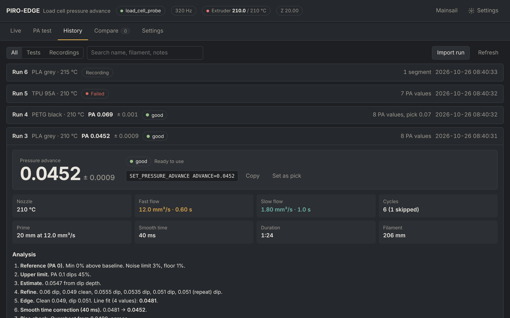
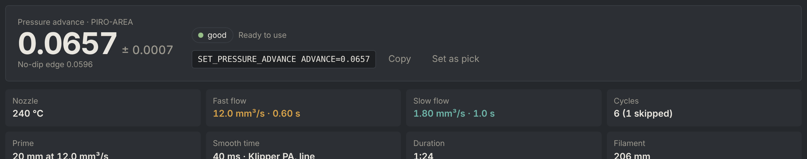
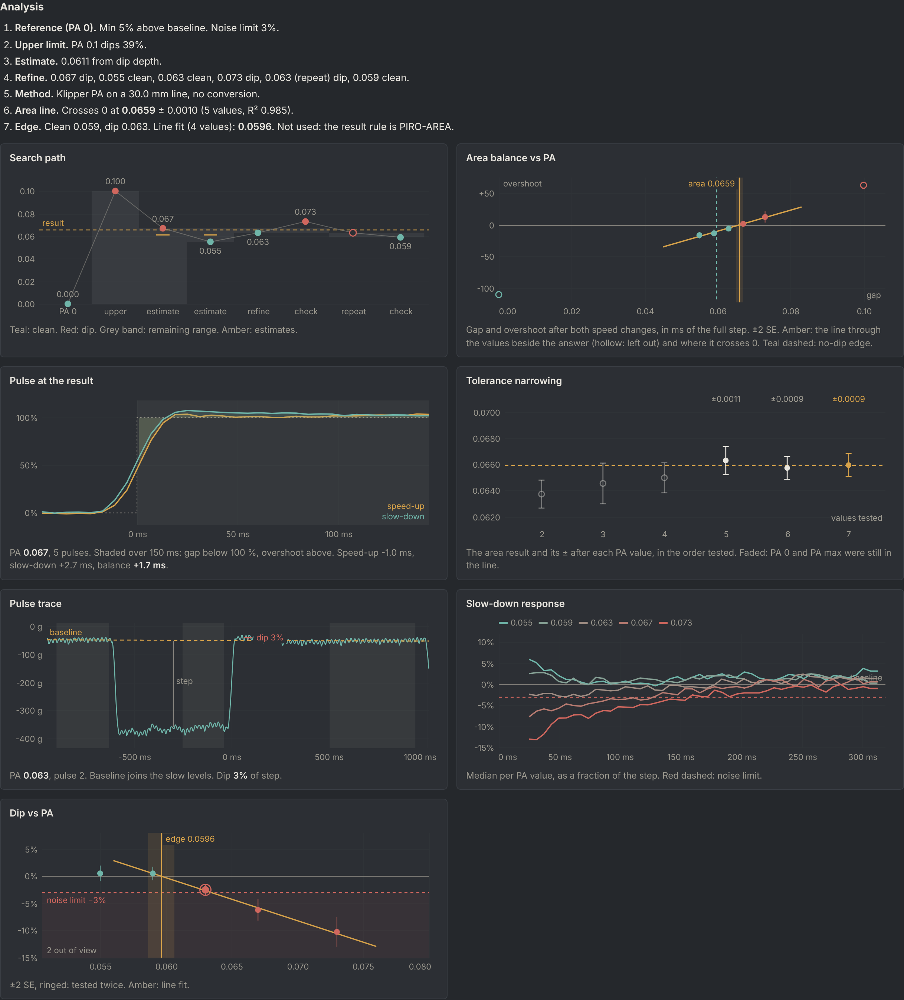

# PIRO-EDGE

Pressure advance calibration for Klipper using the load cell on the **PIRO-AIR** toolhead (HX717, 320 Hz).
The nozzle extrudes fast and slow pulses into the air while the load cell measures the force. The result,
**PIRO-AREA**, is the PA where the gap after every speed change and the overshoot have the same area, with an
uncertainty and a grade. **PIRO-EDGE**, the highest PA before the force dips after the slow-down, is shown beside it.

Tested on printers with more than 200 runs across several filaments.



**[Documentation (wiki)](https://github.com/VcikeyTheCoder/piro-air-pa-calibrator/wiki)**: [Installation](https://github.com/VcikeyTheCoder/piro-air-pa-calibrator/wiki/Installation) ·
[Configuration](https://github.com/VcikeyTheCoder/piro-air-pa-calibrator/wiki/Configuration) · [Commands](https://github.com/VcikeyTheCoder/piro-air-pa-calibrator/wiki/Commands) · [Using the page](https://github.com/VcikeyTheCoder/piro-air-pa-calibrator/wiki/Using-the-page) ·
[Reading a result](https://github.com/VcikeyTheCoder/piro-air-pa-calibrator/wiki/Reading-a-result) · [How PIRO-EDGE works](https://github.com/VcikeyTheCoder/piro-air-pa-calibrator/wiki/How-PIRO-EDGE-works) · [Themes](https://github.com/VcikeyTheCoder/piro-air-pa-calibrator/wiki/Themes) ·
[Troubleshooting](https://github.com/VcikeyTheCoder/piro-air-pa-calibrator/wiki/Troubleshooting)

## Features

- Adaptive search: up to 7 PA values (`max_values`) placed around the answer, about 1 to 2 minutes per filament
- PIRO-AREA result with ± uncertainty, a *good / fair / poor* grade and a graph of how the ± narrows with every value; PIRO-EDGE (no-dip edge) shown beside it
- Mode and method, chosen separately: **mode** = the algorithm judging the curve (`area` PIRO-AREA, default, or `edge` PIRO-EDGE); **method** = how each PA value is applied (`push`, default: exactly Klipper's own PA with no XY motion, or `klipper`: Klipper's own PA on a short XY line). No conversion either way
- Auto PA before every print at the slicer's outer wall flow (OrcaSlicer), set as Klipper's PA, no copying
- Graphs that show how the value was chosen, from the raw pulse to the final line
- Live load cell graph, manual recordings, compare across runs, export and import of runs
- Settings saved to `pa_loadcell.cfg`, six themes (including a tmux + Neovim style Terminal theme) plus custom theme files
- Works with `[load_cell]` and `[load_cell_probe]`

## Install

```bash
cd ~
git clone https://github.com/VcikeyTheCoder/piro-air-pa-calibrator.git
cd piro-air-pa-calibrator && bash install.sh
```

Set `test_x/test_y` and `park_x/park_y` in `pa_loadcell.cfg`, then refresh Mainsail (Ctrl+F5). **Load Cell**
appears in the sidebar. Details: [Installation](https://github.com/VcikeyTheCoder/piro-air-pa-calibrator/wiki/Installation).

| | |
|---|---|
| Update | `cd ~/piro-air-pa-calibrator && git pull && bash install.sh`, or **Update** on Mainsail's Machine page |
| Uninstall | `bash install.sh --uninstall` (config and runs are kept) |

## Commands

| Command | Description |
|---|---|
| `PA_LOADCELL_TEST` | Run the test. Parameters override `[pa_loadcell]`, e.g. `PA_LOADCELL_TEST FILAMENT="PETG black" FAST_FLOW=10` |
| `PA_LOADCELL_TEST MODE=edge` | Judge the curve with PIRO-EDGE for this run (default `mode: area`) |
| `PA_LOADCELL_TEST METHOD=klipper` | Apply PA on a short XY line for this run (default `method: push`) |
| `PA_LOADCELL_DIAG` | Check the load cell stream: expect about 320 samples/s |
| `PA_AUTO {rawparams}` | In PRINT_START: auto PA before every print (`pa_auto.cfg`) |

The test needs the nozzle at `min_temp`, all axes homed and Z at `required_z` (20 mm). Apply the result with
`SET_PRESSURE_ADVANCE ADVANCE=<value>`. All parameters: [Commands](https://github.com/VcikeyTheCoder/piro-air-pa-calibrator/wiki/Commands).

## Auto PA before every print

When pressure advance is off in the OrcaSlicer filament profile, PA is measured at the outer wall flow and wall
temperature, and set. A recent result of the same filament is reused; no usable result sets 0.02.

OrcaSlicer, Machine start G-code (one line):

```
print_start EXTRUDER=[first_layer_temperature] BED=[first_layer_bed_temperature] CHAMBER=[chamber_temperature] PRINT_TEMP={nozzle_temperature[initial_extruder]} PA_ON={if enable_pressure_advance[initial_extruder]}1{else}0{endif} WALL_FLOW={outer_wall_volumetric_speed} FILAMENT="{filament_settings_id[initial_extruder]}" OUTER_ACCEL={outer_wall_acceleration[initial_extruder]}
```

PRINT_START, after the bed mesh:

```
PA_AUTO {rawparams}
```

`pa_auto.cfg` holds four macros, each usable on its own: `PA_AUTO` (called by PRINT_START), `PA_AUTO_POSITION`,
`PA_AUTO_RUN` (Klipper's PA on a line from the PA location at the slicer's outer wall acceleration, or push) and
`PA_AUTO_FLICK` (retract, flick, optional push-off of the purge for printers without a bucket). Settings are
variables at the top of each macro. Details:
[Auto PA before every print](https://github.com/VcikeyTheCoder/piro-air-pa-calibrator/wiki/Auto-PA).

## Example

Run 42 at 240 °C, analysed as PIRO-AREA: 0.0659 ± 0.0010, good. The no-dip edge is 0.0596.





How each value was chosen: [How PIRO-EDGE works](https://github.com/VcikeyTheCoder/piro-air-pa-calibrator/wiki/How-PIRO-EDGE-works).

## Credits

Pulse timing and parts of the analysis are based on [OznLab sensor](https://github.com/ozancs/oznlab-sensor) and
[KAPAT](https://github.com/vzagranichnyy/KAPAT), both GPL-3.0.
