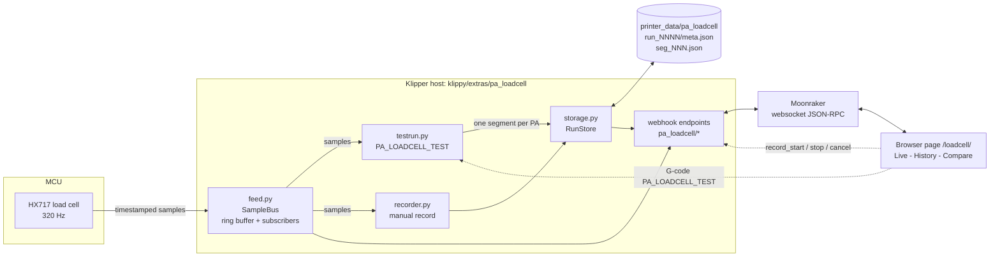
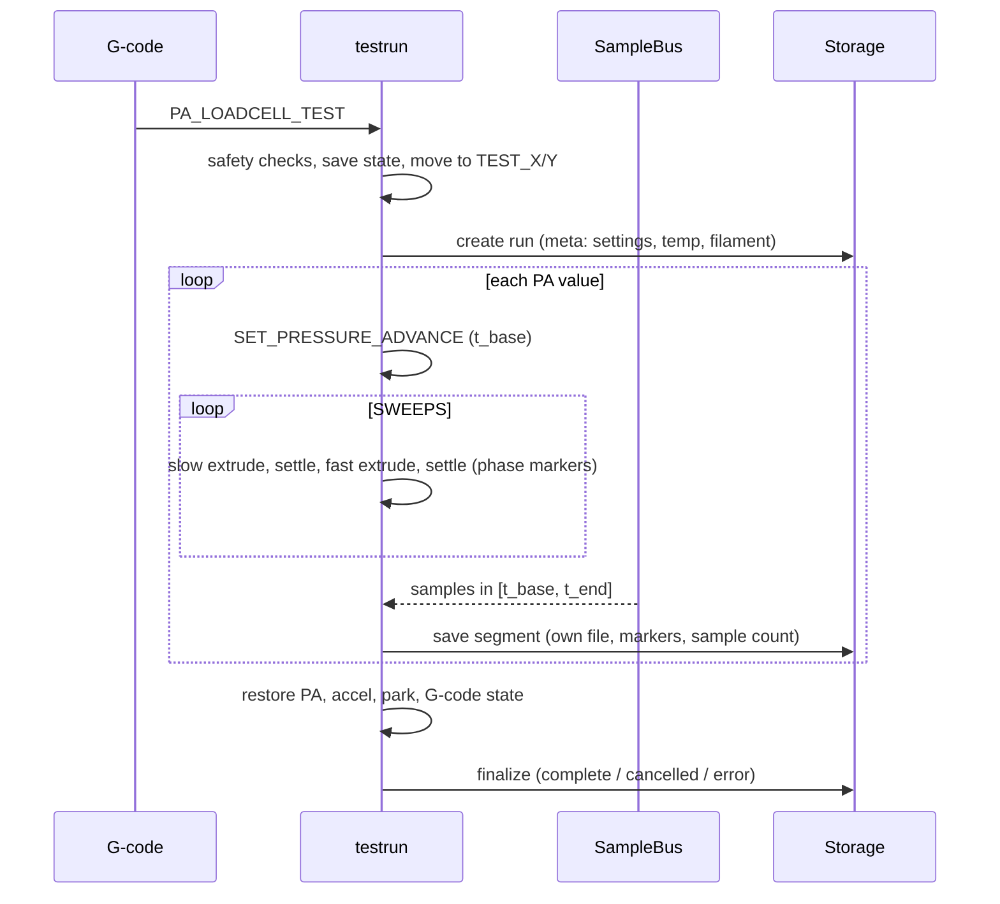

# PA Load Cell Analyzer

Pressure advance (PA) calibration for **Klipper + Mainsail** using a load cell (built and tuned for **HX717 @ 320 Hz**).
The nozzle extrudes into air at a spot you choose, slow and fast, once per PA value. Force is recorded
separately for every PA value, stored on the printer, and viewed on a live / history / compare web page.

> **Status:** record, store and view. Automatic PA fitting / verdict is not implemented yet.
> Not yet tested on real hardware. Run `PA_LOADCELL_DIAG` first (see [Verify](#verify-the-sensor-link)).

## Install

On the Pi (SSH), from the cloned repo:

```bash
./install.sh
```

That's it. It copies the Klipper module, creates `pa_loadcell.cfg` (auto-detects your `[load_cell]`),
adds `[include pa_loadcell.cfg]` to `printer.cfg` (above `SAVE_CONFIG`), installs the page, wires nginx and
restarts Klipper. Backups are saved as `*.bak-pa_loadcell`. Re-running updates safely and keeps your config.

Then: set `park_x/y` and `test_x/y` in `pa_loadcell.cfg`, and open `http://<printer>.local/loadcell/`.

Uninstall: `./install.sh --uninstall` (keeps your config and recorded data).
Overrides (env vars): `KLIPPER_DIR`, `CONFIG_DIR`, `UI_DIR`, `NGINX_SITE`, `KLIPPER_SERVICE`, `NO_RESTART=1`.

## Verify the sensor link

Run in the Mainsail console:

```
PA_LOADCELL_DIAG
```

Expect about 320 samples/s and a small **positive** "behind print_time" value. If it errors, or the delay is large or
negative, `klipper/pa_loadcell/feed.py` (the only file that touches Klipper's load cell API) needs adapting
to your Klipper version. `feed.py` marks its three assumptions.

## Run a test

Heat the nozzle to 200 C or more, home all axes, move Z to 20 mm, then:

```
PA_LOADCELL_TEST PA_START=0 PA_END=0.08 PA_STEP=0.002 SWEEPS=5 EXTRUDE_LEN=10 \
  SLOW_SPEED=2 FAST_SPEED=20 ACCEL=3000 PARK_X=10 PARK_Y=10 TEST_X=150 TEST_Y=10 FILAMENT="PLA red"
```

First try something small: `PA_LOADCELL_TEST PA_START=0 PA_END=0.01 PA_STEP=0.005 SWEEPS=1`

Every parameter is optional; defaults come from `pa_loadcell.cfg`.

| Parameter | Default | Meaning |
|---|---|---|
| `PA_START` `PA_END` `PA_STEP` | 0 / 0.08 / 0.002 | PA range and resolution |
| `SWEEPS` | 5 | slow+fast sweeps per PA value |
| `EXTRUDE_LEN` | 10 | mm of filament per slow / fast phase |
| `SLOW_SPEED` `FAST_SPEED` | 2 / 20 | mm/s of filament |
| `ACCEL` | 3000 | toolhead and extruder-only accel for the test |
| `SETTLE` | 0.5 | seconds of rest after each phase |
| `PARK_X` `PARK_Y` | config | nozzle rests here after the test (also after cancel/error) |
| `TEST_X` `TEST_Y` | config | where the nozzle extrudes into air |
| `FILAMENT` | "" | name stored in run metadata |

Aim for a fast phase of at least 0.3 s (`EXTRUDE_LEN / FAST_SPEED`).

### Safety checks (test aborts with a clear message)

- not all axes homed
- Z not at 20 mm (+/- 0.5)
- nozzle below 200 C
- no load cell found, or no samples for `sample_timeout` seconds
- `FAST_SPEED` above `max_extrude_only_velocity`, or park/test position outside the axes
- **Cancel** (button on the Live tab) stops after the current phase and **keeps everything recorded so far**
  (the cut segment is marked partial `*`). PA, accel and G-code state are always restored.

## How it works



### Test sequence (per PA value)



Key points:

- **One segment per PA value.** Recording starts when PA changes and ends when that value's sweeps finish;
  nothing is mixed into one long stream. Each segment carries slow/fast phase markers.
- **Sensor is streamed only when needed** (test, recording or an open Live tab), so an idle printer carries no extra load.
- **Live view never breaks.** The page polls with a sequence cursor, so a hidden tab or websocket drop resumes without
  losing or duplicating samples. It uses a fixed-size ring buffer, auto-reconnect with backoff, and pauses when the tab is hidden.
- **Cancel and record bypass the G-code queue** (webhooks), so they work while a test is running.

## Web page

Served by nginx at `/loadcell/` (Mainsail has no plugin API, so it is a sibling page on the same host).

- **Live:** scrolling force graph, **Record / Stop** any time (independent of the test; not allowed while a test runs), **Cancel test**.
- **History:** list of runs (tests and manual recordings) with settings. Expand a run, click a PA value for its graph with slow/fast bands.
  Set **your own PA pick and notes** (nearest PA is starred), rename, delete.
- **Compare:** `+ Compare` on any PA graph, from one run or several; overlay with alignment at segment start or first fast phase.

## Data format

```
~/printer_data/pa_loadcell/
  run_0001/
    meta.json      date, kind (test|manual), filament, nozzle_temp, settings, status,
                   pa_pick, notes, segments: [{idx, pa, samples, duration, partial, unit}]
    seg_000.json   {pa, unit, rate, markers:[{name, sweep, t0, t1}], t:[...], f:[...]}
    seg_001.json   one file per PA value (t = seconds from the PA change)
```

`meta.json` is rewritten after every segment, so a crash or cancel never loses finished segments.

## Webhook API

Exposed by Moonraker as `printer.pa_loadcell.<name>` (JSON-RPC) and `/printer/pa_loadcell/<name>` (HTTP):
`live`, `runs`, `run`, `segment`, `tag`, `delete`, `record_start`, `record_stop`, `cancel`.

## Configuration

All defaults live in `klipper/pa_loadcell.cfg` (installed to your config folder). Config-only options:
`min_temp`, `required_z`, `z_tolerance`, `sample_timeout`, `data_dir`, `ring_size`, `live_idle`, `max_record_seconds`.

## Repository layout

```
install.sh                  one-command installer / uninstaller
klipper/pa_loadcell/        Klipper extras package
  __init__.py               registers commands + webhooks
  settings.py               per-run settings, merged config + command params
  feed.py                   SampleBus: the only file touching Klipper's load cell API
  testrun.py                PA_LOADCELL_TEST: safety checks, sweeps, cleanup
  recorder.py               manual recording
  storage.py                Run -> PA values -> data on disk
  errors.py
klipper/pa_loadcell.cfg     all defaults
ui/index.html               single-file web page (no build step)
tests/test_backend.py       offline tests with a fake printer
```

Run the tests: `python3 tests/test_backend.py`

## Troubleshooting

- **Page says "reconnecting":** open it on the same host as Mainsail so `/websocket` resolves.
- **Unknown config section `pa_loadcell`:** the folder must be directly at `klippy/extras/pa_loadcell/` (re-run `./install.sh`).
- **Delay in `PA_LOADCELL_DIAG` large or negative:** timestamps are not in print_time; adapt `feed.py`.
- **Moonraker shows Klipper as dirty:** the installer adds an exclude entry; re-run it if you reinstalled Klipper.
