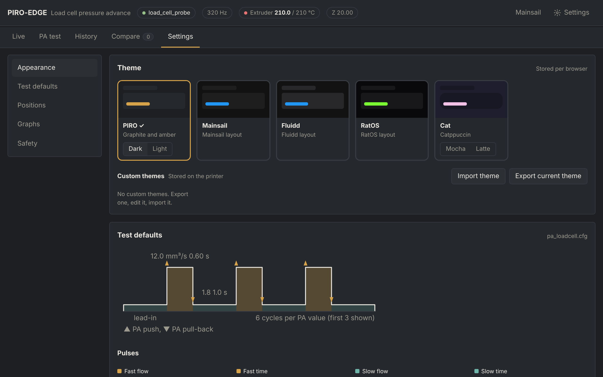
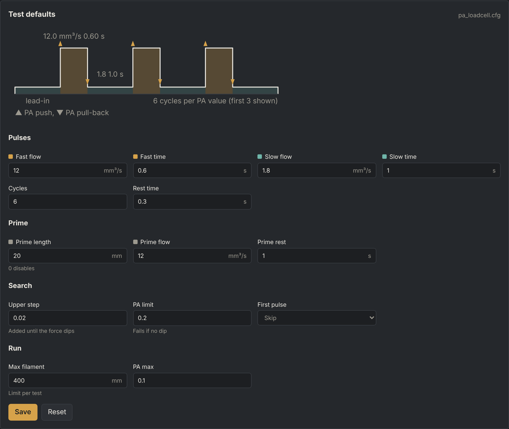
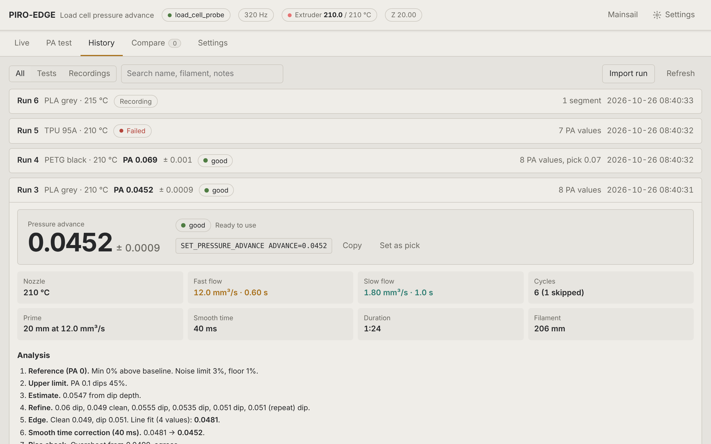
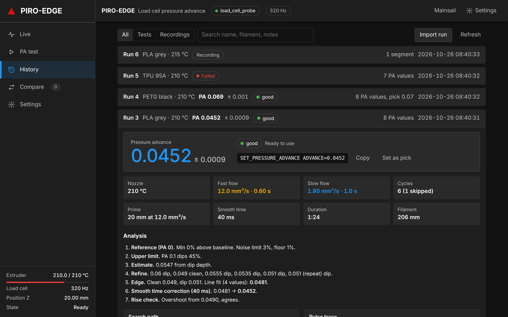
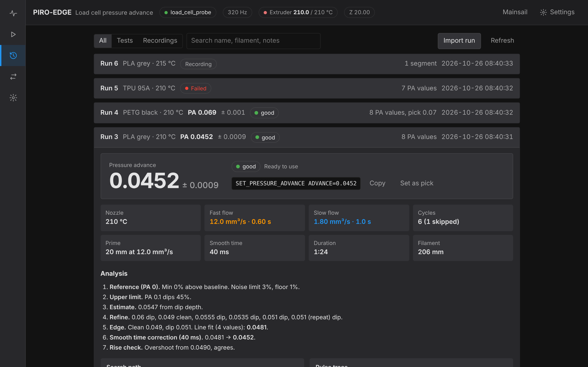
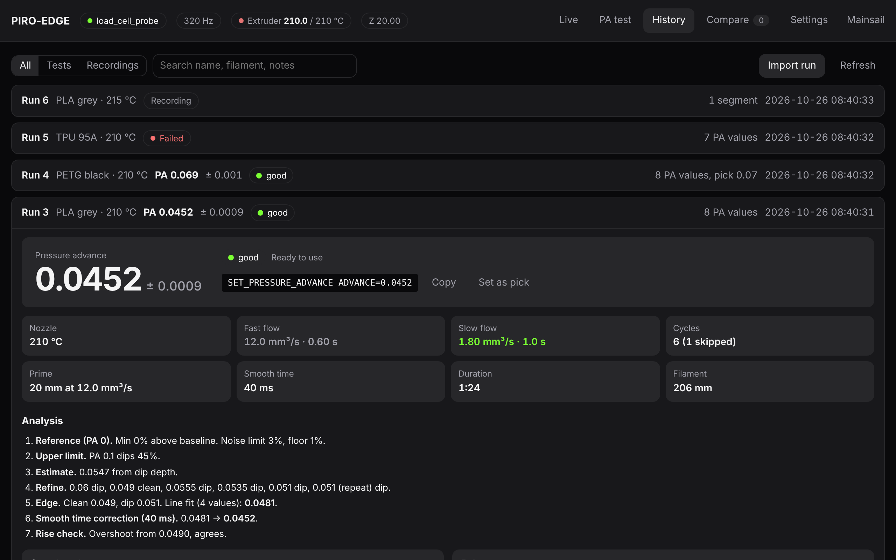
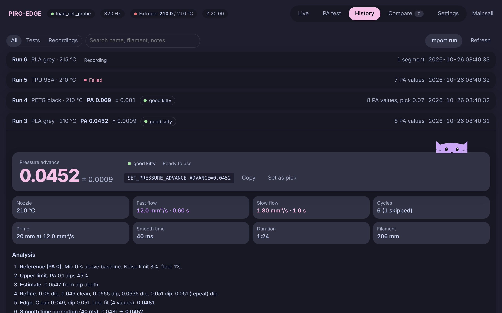
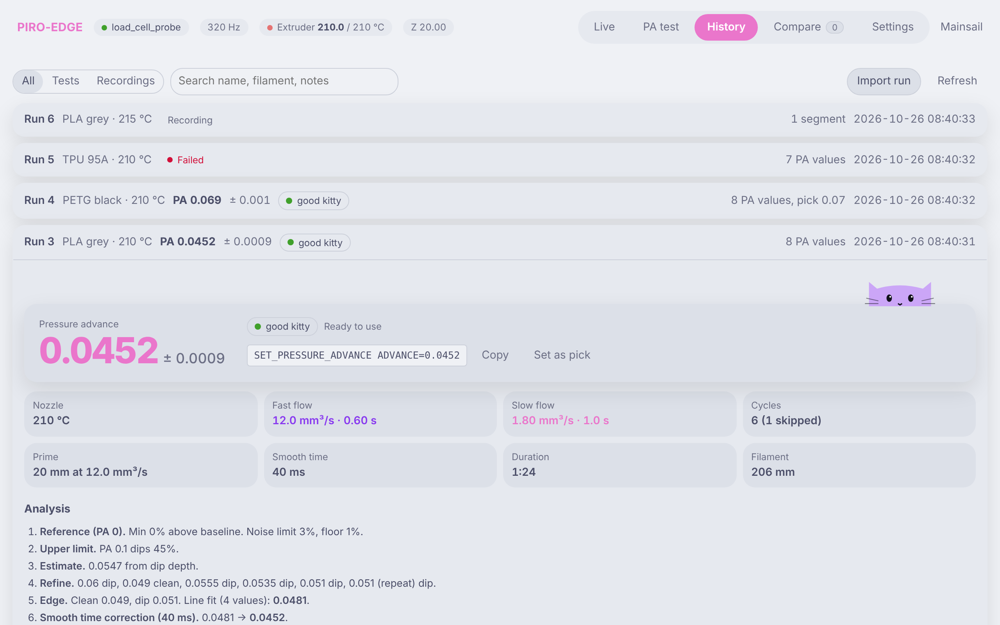

# PIRO-EDGE

Pressure advance calibration for Klipper using the load cell on the **PIRO-AIR** toolhead (HX717, 320 Hz).
The nozzle extrudes fast and slow pulses into the air while the load cell measures the force. PA is raised until the
force dips after the slow-down; the result is where the dip begins, with an error and a grade. Runs from the
**Load Cell** page in the Mainsail sidebar.

Works with `[load_cell]` or `[load_cell_probe]`.

> Tested offline against Klipper's load cell code and a simulated extruder. Not yet verified on every printer. Run
> `PA_LOADCELL_DIAG` once before the first test.

## Install

```bash
git clone https://github.com/VcikeyTheCoder/piro-air-pa-calibrator.git
cd piro-air-pa-calibrator && bash install.sh
```

Update: `cd ~/piro-air-pa-calibrator && git pull && bash install.sh`, or **Update** on Mainsail's Machine page.
Uninstall: `bash install.sh --uninstall`. Config and runs are kept.

The installer links the Klipper module, creates or updates `pa_loadcell.cfg`, adds `[include pa_loadcell.cfg]`,
the sidebar link, the nginx route `/loadcell/` and the Moonraker update entry, then restarts the services.
Existing values are kept and obsolete options are commented out. Backups: `*.bak-pa_loadcell`.

After installing, set `test_x/test_y` and `park_x/park_y`, then refresh Mainsail (Ctrl+F5).

## Configuration

```
[pa_loadcell]
load_cell: load_cell_probe
#   [load_cell] or [load_cell_probe] section name.
pa_max: 0.10
#   First upper PA value.
upper_step: 0.02
#   Added to pa_max until the force dips.
pa_limit: 0.20
#   The test fails if there is no dip up to this value.
cycles: 6
#   Fast + slow pulses per PA value.
fast_flow: 12
fast_time: 0.6
#   Fast leg, mm³/s and s.
slow_flow: 1.8
slow_time: 1.0
#   Slow leg, mm³/s and s.
prime_length: 20
prime_flow: 12
prime_rest: 1
#   Prime before the first PA value: mm, mm³/s, then a pause in s.
#   prime_length 0 disables it.
rest_time: 0.3
#   Pause before each PA value, s.
max_filament: 400
#   Filament limit per test, mm.
skip_first_pulse: 1
#   1 ignores the first pulse of each PA value.
test_x:
test_y:
#   Extrusion position. Required.
park_x:
park_y:
#   Park position after the test. Required.
#filament:
#   Stored with each run.
min_temp: 200
#   Minimum extruder temperature.
required_z: 20
z_tolerance: 0.5
#   Z height at test start.
sample_timeout: 3
#   Seconds without load cell data before the test aborts.
data_dir: ~/printer_data/pa_loadcell
#   Run storage.
ring_size: 60000
live_idle: 15
max_record_seconds: 300
#   Live buffer (samples), streaming time after the last viewer (s),
#   manual recording limit (s).
#config_path:
#   File Settings saves to. Default: pa_loadcell.cfg next to printer.cfg.
```

`[extruder]` needs no changes. Pulses are extrude-only, so `max_extrude_cross_section` does not apply. Fast flow and
the PA push must stay under `max_extrude_only_velocity`; the page and the test check this.

## Commands

#### PA_LOADCELL_TEST
`PA_LOADCELL_TEST [PA_MAX=<value>] [UPPER_STEP=<value>] [PA_LIMIT=<value>] [CYCLES=<count>]
[FAST_FLOW=<mm³/s>] [FAST_TIME=<s>] [SLOW_FLOW=<mm³/s>] [SLOW_TIME=<s>] [PRIME_LENGTH=<mm>] [PRIME_FLOW=<mm³/s>]
[PRIME_REST=<s>] [REST_TIME=<s>] [SKIP_FIRST=<0|1>] [MAX_FILAMENT=<mm>] [TEST_X=<mm>] [TEST_Y=<mm>]
[PARK_X=<mm>] [PARK_Y=<mm>] [FILAMENT=<name>]`: Runs the PIRO-EDGE test. Omitted parameters come from
`[pa_loadcell]`. Requires extruder at `min_temp`, all axes homed and Z at `required_z`. Pressure advance is set to 0
during the test and restored after. The result is printed to the console and saved as a run.

#### PA_LOADCELL_DIAG
`PA_LOADCELL_DIAG`: Reads the load cell for 3 s and reports the sample rate and the delay of the newest sample
behind print time. Expected: about 320 samples/s, 0.1 to 1.0 s.

## The page

Open **Load Cell** in the Mainsail sidebar, or `http://<printer>/loadcell/`.

### Live


Load cell force, last 10 minutes. Drag to pan, scroll to zoom, **Live** to return. **Tare** zeroes the load cell.
**Record** saves a recording; **Mark** adds a note to it.

### PA test


**Start test** runs the test. The step bar shows progress; the graph shows the pulses live. The side panel holds
**Filament**, **PA max** and the last result. All other values are in **Settings**. The summary shows the expected
PA values, duration and filament, and flags values the printer cannot reach.

The header shows extruder temperature (actual / target) and Z.

### History

All runs with their results. Open a test run for its analysis.


| Item | Shows |
|---|---|
| Result | PA value, error (±), grade (*good / fair / poor*), `SET_PRESSURE_ADVANCE` command, warnings |
| Run info | Nozzle temperature, fast and slow flow and time, cycles, prime, smooth time, duration, filament |


| Item | Shows |
|---|---|
| Analysis | Each search step with its values |
| Search path | Tested values in order. Teal: clean. Red: dip |
| Pulse trace | Raw force of one pulse with its baseline |
| Slow-down response | Force after the slow-down at each value |
| Dip vs PA | Dip per value and the line fit to the edge |
| All PA values | One preview per value. Click to open the trace |

Below: **Pick** and notes, **Re-analyse**, **Export run** / **Import run** (`.palc.json`) and **Delete run**.

### Settings



| Section | Contents |
|---|---|
| Appearance | Theme, custom themes |
| Test defaults | `fast_flow`, `fast_time`, `slow_flow`, `slow_time`, `cycles`, `rest_time`, `prime_*`, `upper_step`, `pa_limit`, `skip_first_pulse`, `max_filament`, `pa_max` |
| Positions | `test_x`, `test_y`, `park_x`, `park_y` |
| Graphs | Command line colour |
| Safety | `min_temp`, `required_z`, `z_tolerance`, `sample_timeout` (read only) |

**Save** writes changed values to `[pa_loadcell]` in `pa_loadcell.cfg`. Comments and other sections are kept; the
previous file is saved as `pa_loadcell.cfg.bak-pa_loadcell-ui`. Values are validated first. Saving is blocked while
a test runs. New values apply to the next test without a restart.



The pulse diagram updates as values change.

### Themes

| Theme | Layout |
|---|---|
| PIRO | Graphite and amber, dark or light. Default |
| Mainsail | Sidebar with printer status |
| Fluidd | Icon rail |
| RatOS | Zinc and lime, numbered steps |
| Cat | Catppuccin Mocha (dark) or Latte (light) |

| | |
|---|---|
| **PIRO** dark<br> | **PIRO** light<br> |
| **Mainsail**<br> | **Fluidd**<br> |
| **RatOS**<br> | **Cat** Mocha<br> |
| **Cat** Latte<br> | |

Themes change colours and layout only. The choice is stored per browser. Select one by URL:
`/loadcell/?theme=cat&mode=light`.

**Custom themes.** **Export current theme** downloads the colours as `.json`. Edit the file and load it with
**Import theme**. Custom themes are stored on the printer in `~/printer_data/pa_loadcell/themes/` and shared by all
browsers. Files can also be copied into that folder.

```json
{
  "format": "piro_edge_theme",
  "version": 1,
  "name": "Ocean",
  "author": "you",
  "base": "fluidd",
  "mode": "dark",
  "tokens": { "accent": "#ff6f61", "trace": "#4dd0e1", "bg": "#0d1117" }
}
```

`base`: layout (`piro`, `mainsail`, `fluidd`, `ratos`, `cat`). Missing tokens come from the base.
Tokens: `bg`, `panel`, `panel2`, `head`, `ph`, `rule`, `text`, `dim`, `trace`, `accent`, `onaccent`, `bad`, `good`,
`fair`, `grid`, `fast`, `slow`, `cmd`, `radius`, `font`. Values: colours, sizes and font names only.

### Compare


Press **+** on a PA value in History to overlay it here, as edge response or raw trace.

## Data

Runs are stored in `~/printer_data/pa_loadcell/run_NNNN/`. Runs from older versions are re-analysed with PIRO-EDGE
when first opened.

Webhooks (Moonraker `printer.pa_loadcell.<name>`): `live`, `info`, `defaults`, `runs`, `run`, `segment`, `tag`,
`delete`, `record_start`, `record_stop`, `mark`, `cancel`, `export`, `reanalyze`, `import_begin`, `import_chunk`,
`import_end`, `config_save`, `theme_list`, `theme_save`, `theme_delete`.

## Development

```
python3 tests/test_backend.py                          # offline tests
python3 tests/test_ui_backend.py                       # Settings and theme backend
KLIPPER_DIR=~/klipper python3 tests/test_real_klipper.py # against a Klipper checkout
pip install websockets && python3 tests/harness.py      # page with a simulated printer
```

The harness serves the page at `http://127.0.0.1:8080/?ws=127.0.0.1:8765`.

## Troubleshooting

| Problem | Fix |
|---|---|
| No **Load Cell** in the sidebar | Refresh Mainsail with Ctrl+F5 |
| "No load cell found" | Check `load_cell:` in `pa_loadcell.cfg` |
| Values in counts, not grams | Run `LOAD_CELL_CALIBRATE`, then **Tare** |
| "No dip up to PA 0.200" | Check for filament slip or a partial clog. For soft filament, raise `pa_limit` |
| Grade *poor* | See the result warnings. Raise `cycles` or `fast_flow` |
| Unknown config section `pa_loadcell` | Run `bash install.sh` again |
| "No [pa_loadcell] section in the config file" | Set `config_path:` to the file that holds the section |
| Theme import refused | Check token names and values against the list above |

## Credits

Pulse timing and parts of the analysis are based on [OznLab sensor](https://github.com/ozancs/oznlab-sensor) and [KAPAT](https://github.com/vzagranichnyy/KAPAT), both GPL-3.0.
