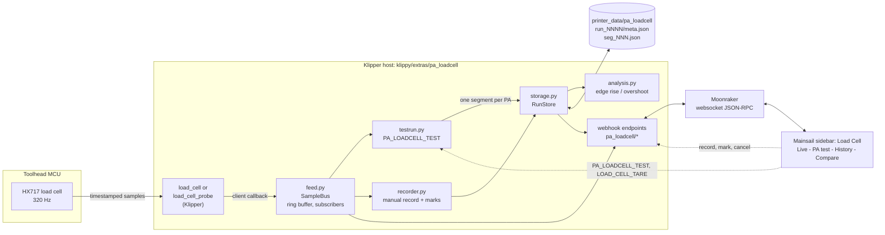
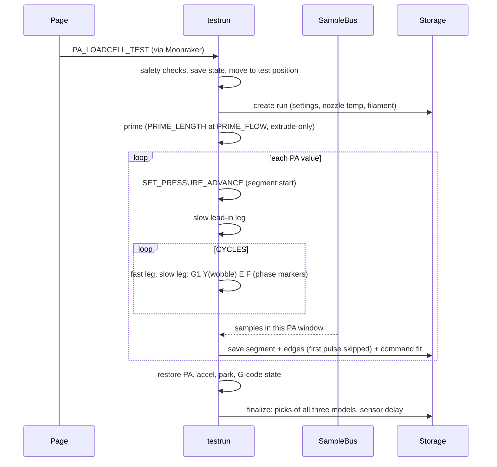

# PA Load Cell Analyzer

Pressure advance (PA) calibration for **Klipper + Mainsail** using a load cell, built for the **PIRO-AIR toolhead**
(HX717 at 320 Hz). Works with `[load_cell]` and `[load_cell_probe]`, whichever your printer has.

The nozzle extrudes into air at a spot you choose, in slow and fast pulses (volumetric flow, same pulse shape as
[KAPAT](https://github.com/vzagranichnyy/KAPAT)), once for every PA value. Force is recorded
separately for each PA value, stored on the printer, and shown in a scope-style page inside your Mainsail sidebar:
live graph, one-click recording, test launcher, history with a thumbnail of every PA value, and an overlay to compare them.

> **Status:** tested offline against Klipper's real load cell code and in a headless browser. Not yet verified on
> real hardware. Run `PA_LOADCELL_DIAG` first (see [Verify](#verify-the-sensor-link)).

## Install

On the Pi (SSH), one command clones the repo and installs:

```bash
git clone https://github.com/VcikeyTheCoder/piro-air-pa-calibrator.git && cd piro-air-pa-calibrator && bash install.sh
```

Update later from Mainsail (**Machine** page, "pa_loadcell", Update) or by hand:
`cd piro-air-pa-calibrator && git pull`. Keep the repo folder where it is: Klipper and the web page are linked to it.

What the installer does (every step is safe to repeat, backups are saved as `*.bak-pa_loadcell`):

1. Links the Klipper module into `klippy/extras/pa_loadcell`.
2. Creates `pa_loadcell.cfg` (detects your load cell section), or updates an existing one (options from older versions
   are commented out, new ones are added, your positions are kept), and adds `[include pa_loadcell.cfg]` above `SAVE_CONFIG`.
3. Links the web page, adds the **Load Cell** entry to the Mainsail sidebar (`.theme/navi.json`) and the nginx route `/loadcell/`.
4. Adds an `[update_manager pa_loadcell]` block to `moonraker.conf` so Mainsail can update it.
5. Restarts Moonraker, nginx and Klipper.

Then add `max_extrude_cross_section: 100` to `[extruder]` in printer.cfg (see [Run a test](#run-a-test) for why),
set `park_x/y` and `test_x/y` in `pa_loadcell.cfg` (spots where the nozzle can extrude into air), refresh
Mainsail with Ctrl+F5, and open **Load Cell** in the sidebar (or `http://<printer>.local/loadcell/`).

Uninstall: `bash install.sh --uninstall` (keeps your config and recorded data).
Env overrides: `KLIPPER_DIR`, `CONFIG_DIR`, `UI_DIR`, `NGINX_SITE`, `KLIPPER_SERVICE`, `MOONRAKER_CONF`, `NO_RESTART=1`.

## Verify the sensor link

Run in the Mainsail console:

```
PA_LOADCELL_DIAG
```

Expect about 320 samples/s and a "behind print_time" value of roughly 0.1 to 1.0 s (the load cell delivers samples in
short batches). A negative value or several seconds means the timestamps are not usable. The Live tab also tells you
what is wrong: no samples, or "not calibrated and tared" (values are then raw ADC counts; press **Tare**, or run
`LOAD_CELL_CALIBRATE` once).

## The page

Open it from the sidebar. All data is live from the printer; the connection reconnects by itself and a hidden tab
resumes without losing samples.

| Tab | What it does |
|---|---|
| **Live** | Big current force, min / max / mean / noise of what is on screen, and the graph. The page keeps the last 10 minutes: drag the graph or the strip under it to go back, **Follow live** (or End) to return. **Tare**. **Record** starts and stops a recording any time (not during a test); **Mark** drops a labelled marker while recording, handy during manual PA tuning. |
| **PA test** | Settings grouped as PA values, Pulse (flows in mm3/s and times), Prime, Motion, Position, Analysis and Run, with a picture of the pulse for one PA value that redraws as you type. A summary shows PA values, time, filament against the cap and leg lengths, and checks your printer's extrusion limit. **Start test**, **Cancel test**, progress (PA value and leg), and a live load cell graph with a marker where each PA value starts. The test height and minimum temperature are shown but only set in the config. |
| **History** | Tests and recordings with their settings. Each test has an **Analysis** panel with the pick of all three models (click a model to use it, change *first pulse* or the *dip* threshold and press **Re-analyse**; the raw samples are never changed). Each PA value shows a thumbnail of the edge the active model uses. **Export run** downloads the whole run as one `.palc.json` file; **Import run** loads such a file (from this or another printer) as a new run you can re-analyse. Click one for the full trace (slow / fast phases shaded, marks shown) in the same scrollable graph as Live (it starts from your Live time window and Y settings, and zooming in loads every sample of that part), or the **Edges** view (every pulse overlaid with the mean). Add your own PA pick and notes, rename, delete, export CSV. |
| **Compare** | Press **+** on any PA value, from one run or several. **Edge response** overlays the average edge of each PA so you can see the shape change: slow and rounded at low PA, a spike above the plateau at high PA. A table lists rise time, overshoot and signal to noise. **Raw trace** overlays the recorded force. |

**Graph controls** (Live and History):

| Control | What it does |
|---|---|
| Drag the graph, or Left / Right arrow | Move back and forward in time |
| Mouse wheel, pinch, or + / - | Zoom the time axis around the cursor |
| Strip under the graph | Shows the whole buffer or run. Drag the box to move, drag its edges to resize, click to jump |
| Start / back / forward / end buttons | Jump to the start, move half a window, jump to the end (Live: back to following) |
| Time window | 1 s to 10 min, whole buffer or run, or a custom number of seconds |
| Y axis | Auto (fits what is on screen) or Fixed with your own min and max; **Use current** copies what you see |
| Invert | Flips every graph so negative is up. Display only: data, CSV and analysis are unchanged |
| Double-click | Live: back to following. History: whole run |

Settings are remembered in your browser. When scrolled back on Live, the time axis shows the clock time.

**Dashed lines** (every graph, toggles next to Invert):

- **Command**: what the extruder was told (the slow / fast flow steps), drawn at the exact leg times and fitted to the
  force (force = offset + gain x flow, from the settled half of every leg). Live during a test as well.
- **PA push**: the extruder motion with pressure advance added (the push / pull spike at every speed change, using the
  PA value and your `pressure_advance_smooth_time`). It is drawn off-scale on purpose: it shows *when* PA acts.
- **Raw / Adjusted**: the measured sensor delay (how long after the command the force starts to move, from the
  crispest PA values) is shown with each run; *Adjusted* shifts the dashed line by it. It does not change any pick.

**Analysis models** (pick shown for all three, the active one is used for thumbnails and the run list):

| Model | Looks at | Picks |
|---|---|---|
| **Rise fast** | speed-up edges | the fastest rise whose overshoot stays under the limit (5 % + 3 / signal-to-noise) |
| **Fall slow** | slow-down edges | the fastest fall whose undershoot stays under the limit |
| **Fall undershoot** (default) | slow-down edges | going up in PA, the first value where the force dips below the settled slow line by more than the noise (max(2 %, 3 / signal-to-noise)) and keeps dipping at the next value; the pick is the PA just before it |

The first pulse of every PA value is skipped by default (it often is not representative). Indicative only: force at
the extruder is not the same as pressure at the nozzle. Your own pick is marked in amber.

Optional embedded view: the page also works inside an iframe with `?embed=1`. In Mainsail, a webcam with service
**HTML Iframe** and URL `/loadcell/?embed=1` shows it on the dashboard (not tested here).

## Run a test

From the PA test tab, or the console. Preheat to 200 C or more, home all axes, move Z to 20 mm, then:

```
PA_LOADCELL_TEST PA_START=0 PA_END=0.08 PA_STEP=0.005 CYCLES=4 FAST_FLOW=19.24 FAST_TIME=0.25 \
  SLOW_FLOW=1.92 SLOW_TIME=1 PRIME_LENGTH=40 PRIME_FLOW=5 WOBBLE=0.05 WOBBLE_AXIS=Y ACCEL=1000 MAX_FILAMENT=400 \
  MODEL=fall_undershoot SKIP_FIRST=1 \
  PARK_X=10 PARK_Y=10 TEST_X=150 TEST_Y=10 FILAMENT="PLA red"
```

First try something small: `PA_LOADCELL_TEST PA_START=0 PA_END=0.01 PA_STEP=0.005 CYCLES=1`

### What the nozzle does

First a prime: `PRIME_LENGTH` mm of filament at `PRIME_FLOW` mm3/s (extrude-only, split into pieces that respect
`max_extrude_only_distance`), then straight into the first PA value with no pause. For every PA value: set the PA,
one slow lead-in leg, then `CYCLES` pairs of a fast leg and a slow leg, back to back with no pause.

Every leg is one move: `G1 Y<y> E<mm> F<feed>`. The nozzle moves `WOBBLE` mm (alternating forward and back) while it
extrudes, and the feed is set so the leg lasts exactly `FAST_TIME` or `SLOW_TIME`. The wobble is what makes the test
work: **Klipper only applies pressure advance to moves that include X or Y motion**
(`can_pressure_advance` in `klippy/kinematics/extruder.py`), so a plain `G1 E` would give the same force at every PA.

Because each leg extrudes millimetres of filament over 0.05 mm of travel, Klipper's over-extrusion check
must allow it. Add this to `[extruder]` (the PA test tab shows the exact value your settings need):

```
max_extrude_cross_section: 100
```

That check only exists to catch slicer mistakes; raising it does not change how prints are extruded.

`ACCEL` is set with `SET_VELOCITY_LIMIT`, so it applies to the toolhead (X/Y). The extruder's own limits
(`max_extrude_only_velocity`, `max_extrude_only_accel`) are not changed: they only apply to extrude-only moves, which
the test does not use. Speed and flow overrides (M220 / M221) are set to 100 % during the test and restored after.

| Parameter | Default | Meaning |
|---|---|---|
| `PA_START` `PA_END` `PA_STEP` | 0 / 0.08 / 0.005 | PA range and resolution |
| `CYCLES` | 4 | fast + slow pulses per PA value (the first is skipped in analysis by default) |
| `FAST_FLOW` `FAST_TIME` | 19.24 mm3/s / 0.25 s | fast leg (2.0 mm of 1.75 mm filament) |
| `SLOW_FLOW` `SLOW_TIME` | 1.92 mm3/s / 1.0 s | lead-in and slow legs (0.8 mm) |
| `PRIME_LENGTH` `PRIME_FLOW` | 40 mm / 5 mm3/s | prime before the first PA value (0 = no prime) |
| `MODEL` | fall_undershoot | analysis model: `rise_fast`, `fall_slow` or `fall_undershoot` |
| `SKIP_FIRST` | 1 | 1 = ignore the first pulse of every PA value in the analysis |
| `WOBBLE` `WOBBLE_AXIS` | 0.05 mm / Y | X or Y travel per leg; 0 turns it off (then PA has no effect) |
| `ACCEL` | 1000 | toolhead (X/Y) acceleration during the test |
| `MAX_FILAMENT` | 400 mm | a test that would use more is refused |
| `PARK_X` `PARK_Y` | config | nozzle rests here after the test (also after cancel or error) |
| `TEST_X` `TEST_Y` | config | where the nozzle extrudes into air |
| `FILAMENT` | empty | name stored in run metadata |

With the defaults a test has 17 PA values, takes about 2 minutes and uses about 245 mm of filament (40 mm of it prime).
The filament cross-section comes from your `[extruder]` `filament_diameter`.

### Safety checks (the test aborts with a clear message)

- not all axes homed, Z not at `required_z` (+/- `z_tolerance`), nozzle below `min_temp`
- no load cell found, or no samples for `sample_timeout` seconds
- `PRIME_FLOW` faster than `max_extrude_only_velocity` allows
- more filament than `MAX_FILAMENT`, `max_extrude_cross_section` too low for the pulses (the message gives the line to add),
  park/test position (plus the wobble) outside the axes, or with `WOBBLE=0` a fast leg above `max_extrude_only_velocity`
- **Cancel** stops after the current leg and keeps everything recorded so far (the cut segment is marked partial).
  PA, accel and G-code state are always restored.

## How it works





Key points:

- **One segment per PA value**, starting at the PA change and ending when that value's pulses finish. Nothing is mixed
  into one long stream. Each segment carries slow / fast phase markers and its own sample count.
- **Whichever load cell you have.** The data comes from Klipper's own load cell feed (`[load_cell]` or the load cell
  inside `[load_cell_probe]`), so the HX717 is not read twice and probing is unaffected. Grams are used when the sensor
  is calibrated and tared, raw counts otherwise.
- **Streams only when needed** (a test, a recording or an open Live tab).
- **Live view never breaks.** The page polls with a sequence cursor, so a hidden tab or a websocket drop resumes without
  losing or duplicating samples; the server tells the page to reset if Klipper restarted or the unit changed.
- **Cancel, record and mark bypass the G-code queue** (webhooks), so they work while a test is running.

## Data

```
~/printer_data/pa_loadcell/
  run_0001/
    meta.json      date, kind (test|manual), filament, nozzle_temp, settings, status, pa_pick, notes, flows,
                   smooth_time, analysis:{model, skip_first, dip_min, picks:{model:{pa, idx, why}}, offset},
                   segments: [{idx, pa, samples, duration, partial, unit, edge:{rise,fall}, cmd:{offset,gain}}]
    seg_000.json   {pa, unit, rate, flows, markers:[{name, sweep, t0, t1} | {name:"mark", label, t0}], t:[...], f:[...]}
```

`meta.json` is rewritten after every segment, so a crash or cancel never loses finished segments. Everything under
`analysis`, `edge` and `cmd` is derived from the samples and is recomputed by Re-analyse. An exported run is
`{"format": "pa_loadcell_run", "version": 1, "meta": ..., "segments": [...]}`.
`edge` holds the averaged, normalised edge (80 points) plus `rise` (10 to 90 % seconds), `overshoot`, `snr` and the number of edges.

## Webhook API

Exposed by Moonraker as `printer.pa_loadcell.<name>` (JSON-RPC) and `/printer/pa_loadcell/<name>` (HTTP):
`live`, `info`, `defaults`, `runs`, `run`, `segment`, `tag`, `delete`, `record_start`, `record_stop`, `mark`, `cancel`,
`export` (`run`), `reanalyze` (`run`, optional `model`, `skip_first`, `dip_min`), and `import_begin` / `import_chunk`
(`token`, `seq`, `data`) / `import_end` (`token`) for uploading a run file in pieces. `live` also returns the leg
schedule (`legs` since `leg_seq`) used for the live dashed line.

`segment` takes `run`, `idx`, `max_points` (0 = every sample) and optional `t0` / `t1` (seconds from the segment start) to
return only that stretch. It also returns `span` (first and last time) and `decimated`.

## Configuration

All defaults live in `klipper/pa_loadcell.cfg` (installed to your config folder). Config-only options:
`min_temp`, `required_z` (the Z height the test needs, default 20 mm), `z_tolerance`, `sample_timeout`, `data_dir`, `ring_size`, `live_idle`, `max_record_seconds`.

## Repository layout

```
install.sh                  one-command installer / uninstaller
klipper/pa_loadcell/        Klipper extras package
  __init__.py               commands + webhooks
  settings.py               per-run settings, config + command parameters merged
  feed.py                   SampleBus: the only file touching Klipper's load cell API
  testrun.py                PA_LOADCELL_TEST: safety checks, wobble pulses, cleanup
  recorder.py               manual recording and marks
  analysis.py               edge rise time / overshoot (pure Python)
  storage.py                Run -> PA values -> data on disk
klipper/pa_loadcell.cfg     all defaults
ui/index.html               the page (single file, no build step)
tests/test_backend.py       offline tests with a fake printer
tests/test_real_klipper.py  checks feed.py against a real Klipper checkout (optional)
tests/harness.py            runs the real backend + the page with fake physics, no printer needed
```

Run the tests: `python3 tests/test_backend.py`. Optional check against your Klipper:
`KLIPPER_DIR=~/klipper python3 tests/test_real_klipper.py` (needs `pip install numpy pyserial cffi greenlet jinja2`).
Try the page without a printer: `pip install websockets && python3 tests/harness.py`, then open
`http://127.0.0.1:8080/?ws=127.0.0.1:8765`. Add `SPEED=10` in front to run the fake printer ten times faster
(fills the 10 minute Live buffer in one minute).

## Troubleshooting

- **Nothing in the sidebar:** refresh Mainsail with Ctrl+F5. The link comes from `~/printer_data/config/.theme/navi.json`.
- **Page says "Offline, reconnecting":** open it on the same host as Mainsail so `/websocket` resolves.
- **"No load cell found":** check `load_cell:` in `pa_loadcell.cfg`; both `[load_cell]` and `[load_cell_probe]` are tried.
- **Values are raw counts:** the load cell is not calibrated and tared; press **Tare** or run `LOAD_CELL_CALIBRATE`.
- **Unknown config section `pa_loadcell`:** `klippy/extras/pa_loadcell` must exist (re-run `bash install.sh`).
- **Delay in `PA_LOADCELL_DIAG` large or negative:** timestamps are not in print_time; adapt `feed.py`.
- **Moonraker shows Klipper as dirty:** the installer adds an exclude entry; re-run it if you reinstalled Klipper.
