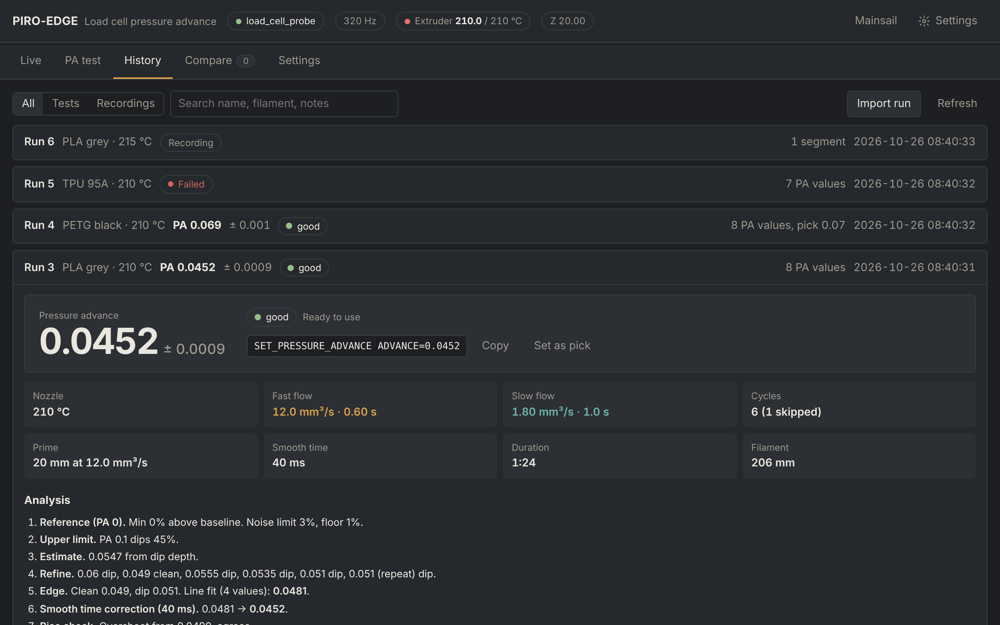
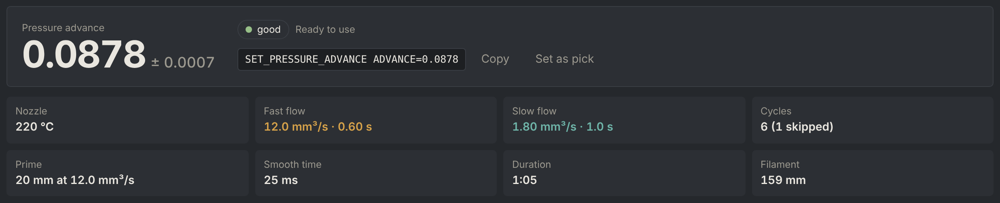
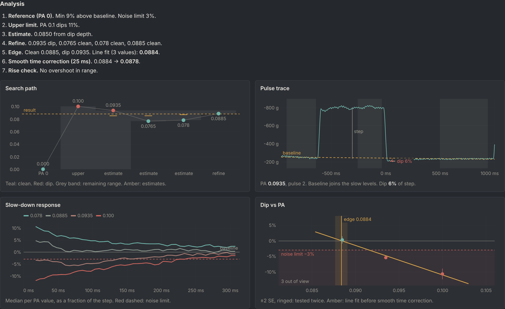

# PIRO-EDGE

Pressure advance calibration for Klipper using the load cell on the **PIRO-AIR** toolhead (HX717, 320 Hz).
The nozzle extrudes fast and slow pulses into the air while the load cell measures the force. PA is raised until
the force dips after the slow-down; the result is where the dip begins, with an uncertainty and a grade.

Tested on printers with more than 200 runs across several filaments.



**[Documentation (wiki)](https://github.com/VcikeyTheCoder/piro-air-pa-calibrator/wiki)**: [Installation](https://github.com/VcikeyTheCoder/piro-air-pa-calibrator/wiki/Installation) ·
[Configuration](https://github.com/VcikeyTheCoder/piro-air-pa-calibrator/wiki/Configuration) · [Commands](https://github.com/VcikeyTheCoder/piro-air-pa-calibrator/wiki/Commands) · [Using the page](https://github.com/VcikeyTheCoder/piro-air-pa-calibrator/wiki/Using-the-page) ·
[Reading a result](https://github.com/VcikeyTheCoder/piro-air-pa-calibrator/wiki/Reading-a-result) · [How PIRO-EDGE works](https://github.com/VcikeyTheCoder/piro-air-pa-calibrator/wiki/How-PIRO-EDGE-works) · [Themes](https://github.com/VcikeyTheCoder/piro-air-pa-calibrator/wiki/Themes) ·
[Troubleshooting](https://github.com/VcikeyTheCoder/piro-air-pa-calibrator/wiki/Troubleshooting)

## Features

- Adaptive search: usually 6 to 8 PA values instead of a fixed sweep, about 1 to 2 minutes per filament
- Result with ± uncertainty and a *good / fair / poor* grade, converted to Klipper's smoothed PA
- Two methods: test push (no motion) or Klipper's own PA on a short line, to compare them on your printer
- Auto PA before every print at the slicer's outer wall flow (OrcaSlicer), set as Klipper's PA, no copying
- Graphs that show how the value was chosen, from the raw pulse to the final line fit
- Live load cell graph, manual recordings, compare across runs, export and import of runs
- Settings saved to `pa_loadcell.cfg`, six themes (including a tmux + Neovim style Terminal theme) plus custom theme files
- Works with `[load_cell]` and `[load_cell_probe]`

## Install

```bash
cd ~
git clone https://github.com/VcikeyTheCoder/piro-air-pa-calibrator.git
cd piro-air-pa-calibrator && bash install.sh
```

Set `test_x/test_y` and `park_x/park_y` in `pa_loadcell.cfg`, then refresh Mainsail (Ctrl+F5). **Load Cell**
appears in the sidebar. Details: [Installation](https://github.com/VcikeyTheCoder/piro-air-pa-calibrator/wiki/Installation).

| | |
|---|---|
| Update | `cd ~/piro-air-pa-calibrator && git pull && bash install.sh`, or **Update** on Mainsail's Machine page |
| Uninstall | `bash install.sh --uninstall` (config and runs are kept) |

## Commands

| Command | Description |
|---|---|
| `PA_LOADCELL_TEST` | Run the test. Parameters override `[pa_loadcell]`, e.g. `PA_LOADCELL_TEST FILAMENT="PETG black" FAST_FLOW=10` |
| `PA_LOADCELL_TEST PA_METHOD=klipper` | The same test with Klipper's own PA and smoothing (short back-and-forth line) |
| `PA_LOADCELL_DIAG` | Check the load cell stream: expect about 320 samples/s |
| `PA_AUTO {rawparams}` | In PRINT_START: auto PA before every print (`pa_auto.cfg`) |

The test needs the nozzle at `min_temp`, all axes homed and Z at `required_z` (20 mm). Apply the result with
`SET_PRESSURE_ADVANCE ADVANCE=<value>`. All parameters: [Commands](https://github.com/VcikeyTheCoder/piro-air-pa-calibrator/wiki/Commands).

## Auto PA before every print

When pressure advance is off in the OrcaSlicer filament profile, PA is measured at the outer wall flow and wall
temperature, and set. A recent result of the same filament is reused; no usable result sets 0.02.

OrcaSlicer, Machine start G-code (one line):

```
print_start EXTRUDER=[first_layer_temperature] BED=[first_layer_bed_temperature] CHAMBER=[chamber_temperature] PRINT_TEMP={nozzle_temperature[initial_extruder]} PA_ON={if enable_pressure_advance[initial_extruder]}1{else}0{endif} WALL_FLOW={outer_wall_volumetric_speed} FILAMENT="{filament_settings_id[initial_extruder]}"
```

PRINT_START, after the bed mesh:

```
PA_AUTO {rawparams}
```

Position, retract and flick are variables in `pa_auto.cfg`. Details:
[Auto PA before every print](https://github.com/VcikeyTheCoder/piro-air-pa-calibrator/wiki/Auto-PA).

## Example

Fibreel red PLA at 220 °C: 6 PA values, 1:05, 159 mm of filament.





How each value was chosen: [How PIRO-EDGE works](https://github.com/VcikeyTheCoder/piro-air-pa-calibrator/wiki/How-PIRO-EDGE-works).

## Credits

Pulse timing and parts of the analysis are based on [OznLab sensor](https://github.com/ozancs/oznlab-sensor) and
[KAPAT](https://github.com/vzagranichnyy/KAPAT), both GPL-3.0.
